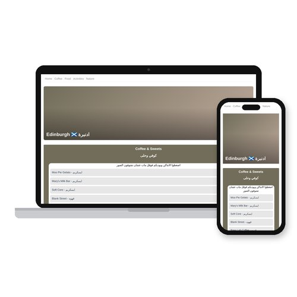

# Edinburgh Travel Guide

**Live site:** https://irbala.github.io/edinburgh/

  

Click a screenshot to open the live site.

A bilingual (English and Arabic) one-page guide to Edinburgh. Every place links to Google Maps so you can see photos and directions.

## Sections

- **Coffee & Sweets · كوفي وحلى**
- **Food · الاكل**
- **Activities & Shopping · تسوق وفعاليات**
- **Nature · طبيعة وتمشية**

A fixed menu at the top jumps to each section.

## How it's built

- Plain HTML and CSS, with no frameworks, build step or JavaScript
- `style.css` holds all the styles, with each section's colour set as a variable at the top
- Fonts: Plus Jakarta Sans for English and Noto Sans Arabic for Arabic
- The page is English left-to-right, and each piece of Arabic text is marked with `lang="ar"` so browsers and screen readers handle it correctly

## Design Decisions

- **A colour for each section.** Coffee & Sweets is coffee brown, Food is warm taupe, Activities is deep green and Nature is olive. The colour tells you where you are as you scroll.
- **Bilingual without two pages.** The page is English and left to right, and every Arabic label is wrapped in ``, so screen readers switch voice and the browser uses the Arabic font for just those words.
- **Font pairing.** Plus Jakarta Sans for English and Noto Sans Arabic for Arabic, chosen so the two scripts sit comfortably side by side. <!-- guess: Fay, please confirm or edit -->
- **Links instead of photos.** Each place links to Google Maps, which already has photos, reviews and directions, so the guide itself stays light and fast.
- **Fixed top menu** to jump between the four sections.

## Accessibility

Checked on 19 November 2026 with [axe-core](https://github.com/dequelabs/axe-core) 4.10, the engine behind Lighthouse's accessibility score, against WCAG 2.1 A and AA plus axe's best-practice rules. Every page was tested in a desktop browser.

| Page | Issues | Rules passed |
|---|---|---|
| `index.html` | ✅ 0 issues | 31 |

Fixed in this round:

- The Food section colour was too light for its white heading (2.2:1). It is now a deeper taupe in the same warm tone that passes contrast for large text.

## Run it locally

Download or clone the repo and open `index.html` in a browser.
